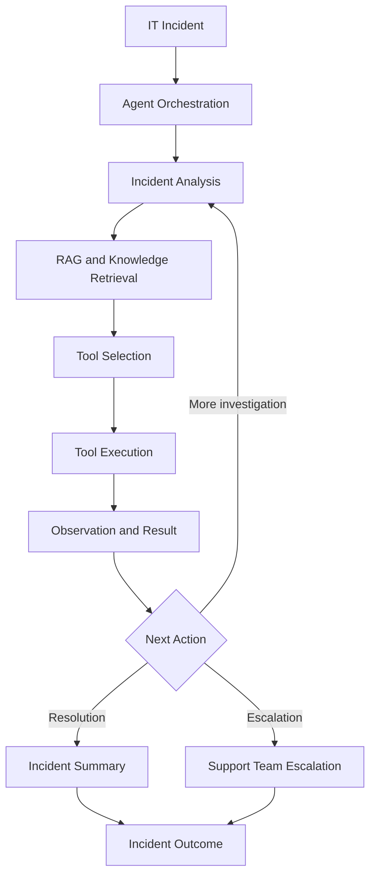

# SentinelAI 🤖
### Autonomous IT Incident Response and Service Desk Agent

**SentinelAI** is an AI-powered IT service desk agent developed for the AIE580S–DSE580S group assignment. It demonstrates how artificial intelligence, Retrieval-Augmented Generation (RAG), tool calling, and ReAct-style agent workflows can be combined to investigate IT incidents, retrieve relevant troubleshooting knowledge, execute diagnostic actions, and support incident resolution or escalation.

The system brings together an AI-powered agent, a structured troubleshooting knowledge base, incident-management tools, simulated diagnostics and remediation, and a local dashboard for demonstrating incident-response workflows.

**Repository:** [Asante071/Sentinal-ai-agent](https://github.com/Asante071/Sentinal-ai-agent)

---

## Table of Contents

- [Project Overview](#-project-overview)
- [Key Features](#-key-features)
- [System Architecture](#-system-architecture)
- [How SentinelAI Works](#-how-sentinelai-works)
- [Implemented Capabilities](#-implemented-capabilities)
- [Demonstration Scenarios](#-demonstration-scenarios)
- [Technology Stack](#-technology-stack)
- [Project Structure](#-project-structure)
- [Installation and Setup](#-installation-and-setup)
- [Running SentinelAI](#-running-sentinelai)
- [Testing and Evaluation](#-testing-and-evaluation)
- [Configuration and Security](#-configuration-and-security)
- [Scope and Limitations](#-scope-and-limitations)
- [Future Applications](#-future-applications)
- [Acknowledgements](#-acknowledgements)

---

## 🎯 Project Overview

Traditional IT service desks often rely on manual investigation, repetitive troubleshooting procedures, and escalation between support teams. These processes can increase resolution time and create additional workloads for IT support personnel.

SentinelAI explores an agent-based approach to IT incident response. Instead of relying exclusively on predefined responses, the system demonstrates how an agent can interpret an incident, retrieve relevant knowledge, select tools, observe their results, and determine an appropriate next action.

The project combines AI agent engineering, knowledge retrieval, incident-management functions, and evaluation workflows in a runnable Python application.

### Project Objectives

- Demonstrate an AI agent capable of investigating common IT support incidents.
- Apply a ReAct-style workflow involving reasoning, actions, and observations.
- Retrieve relevant troubleshooting information using Retrieval-Augmented Generation.
- Use tools for incident lookup, diagnostics, updates, remediation, and escalation.
- Demonstrate incident-response workflows through a local dashboard.
- Evaluate system behaviour using test scenarios and recorded experiment results.

## ✨ Key Features

| Feature | Description |
|---|---|
| AI agent integration | Gemini-powered agent for interpreting incidents and selecting tools. |
| ReAct-style workflow | Demonstrates iterative interaction between an agent, tools, and observations. |
| Retrieval-Augmented Generation | Retrieves relevant troubleshooting knowledge to support incident investigation. |
| Knowledge-base search | Searches documented procedures for common IT issues. |
| Incident management | Supports incident lookup, status updates, and structured summaries. |
| Diagnostic tools | Simulates checks for common VPN, network, printer, and email problems. |
| Remediation workflows | Demonstrates corrective actions for selected incident scenarios. |
| Escalation handling | Routes unresolved or specialised incidents to an appropriate support team in the simulated workflow. |
| Local dashboard | Provides a visual interface for demonstrating incident-response processes. |
| Memory support | Includes a component for storing and retrieving incident context. |
| Testing and evaluation | Includes automated tests, evaluation scenarios, result files, and supporting evidence. |

## 🏗️ System Architecture

SentinelAI is organised into cooperating components that support incident investigation and response.

### Main Components

**Agent layer**

Coordinates incident investigation, agent decisions, tool selection, and observations. The project includes Gemini-powered and local ReAct-style agent components.

**Retrieval layer**

Retrieves relevant information from troubleshooting knowledge bases to provide context for incident investigation.

**Tool layer**

Provides functions for knowledge search, incident lookup and updates, diagnostics, remediation, escalation, and incident summaries.

**Application and dashboard layer**

Provides entry points for running the agent and demonstrating local incident-response workflows.

**Evaluation layer**

Contains test scenarios, baseline evaluation components, result files, and evidence used to assess system behaviour.

The local dashboard and Gemini-powered agent are separate prototype components with distinct execution paths.

## 🔄 How SentinelAI Works

The incident-response workflow follows these stages:

1. **Incident intake:** An IT support incident is selected or supplied to the system.
2. **Incident analysis:** The agent interprets the reported issue and identifies relevant information.
3. **Knowledge retrieval:** The system searches troubleshooting documentation for useful context.
4. **Tool selection:** The agent selects an appropriate diagnostic or incident-management tool.
5. **Tool execution:** The selected tool performs its configured operation.
6. **Observation:** The agent receives the tool result and uses it to guide the next step.
7. **Decision:** The workflow continues investigating, demonstrates resolution, or escalates the incident.
8. **Incident summary:** A structured summary records the outcome of the workflow.

This approach demonstrates an agent-oriented incident-response process rather than a simple question-and-answer interface.

## 🧩 Implemented Capabilities

### 1. AI Agent and Orchestration

The project includes Gemini integration, agent orchestration, tool definitions, retry handling, and a local ReAct-style workflow.

The Gemini-powered execution path demonstrates how an AI model can select tools and use returned observations. The local workflow provides a separate path for demonstrating deterministic incident-response behaviour.

### 2. Retrieval-Augmented Generation

SentinelAI includes knowledge retrieval components that search IT troubleshooting information.

The available knowledge-base material covers topics such as:

- VPN connectivity and authentication
- Network troubleshooting
- Printer issues
- Email troubleshooting
- Account access and password-related incidents

Retrieval components and evaluation scripts support experimentation with knowledge matching and retrieval quality.

### 3. Incident and Support Tools

The application contains tool modules for:

- Knowledge search
- Incident lookup
- Incident updates
- Diagnostic checks
- Remediation workflows
- Escalation
- Incident summaries

The tools provide the operations used by the agent and the local demonstration workflows.

### 4. Dashboard

The local dashboard demonstrates the incident-response workflow through a visual interface. Depending on the selected execution path, demonstrations include incident selection, knowledge retrieval, diagnostic results, remediation, escalation, and incident summaries.

### 5. Memory

A memory component is included for storing and retrieving contextual information across supported interactions. Its behaviour depends on the configured execution path and persistence settings.

### 6. Testing and Evaluation

The repository includes automated test modules, evaluation scenarios, baseline components, recorded results, and supporting evidence.

These resources support the examination of agent behaviour, knowledge retrieval, memory, and selected workflow outcomes.

## 🖥️ Demonstration Scenarios

The project includes representative scenarios for common IT service desk incidents.

### Scenario 1: VPN Authentication Failure

**Incident:** `INC-1001`

Demonstration workflow:

1. Retrieve VPN troubleshooting information.
2. Perform the configured VPN diagnostic.
3. Identify the simulated authentication problem.
4. Demonstrate escalation to the Identity and Access team.

### Scenario 2: Printer Not Printing

**Incident:** `INC-1002`

Demonstration workflow:

1. Retrieve printer troubleshooting information.
2. Perform the configured printer diagnostic.
3. Identify a simulated stalled print queue.
4. Demonstrate the queue-clearing and test-print workflow.
5. Present the resulting incident outcome.

### Scenario 3: Email Access Problem

**Incident:** `INC-1003`

Demonstration workflow:

1. Retrieve relevant email troubleshooting information.
2. Perform the configured email diagnostic.
3. Identify a simulated mail-client problem.
4. Demonstrate a restart or reconnection action.
5. Present the resulting incident outcome.

These scenarios demonstrate configured workflows. They do not imply that the application directly modifies production enterprise systems.

## 🛠️ Technology Stack

The project primarily uses Python and includes the following technologies and approaches:

- **Python** — application logic, agent tools, testing, and orchestration.
- **Google Gemini API** — language-model integration for the Gemini-powered agent.
- **Retrieval-Augmented Generation (RAG)** — retrieval of relevant troubleshooting information.
- **ChromaDB** — vector database technology used by the retrieval components.
-