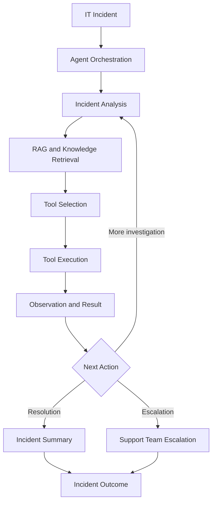

# SentinelAI 🤖
### Autonomous IT Incident Response and Service Desk Agent

**SentinelAI** is an AI-powered IT service desk agent developed for the AIE580S–DSE580S group assignment. It demonstrates how artificial intelligence, Retrieval-Augmented Generation (RAG), tool calling, and ReAct-style agent workflows can be combined to investigate IT incidents, retrieve relevant troubleshooting knowledge, execute diagnostic actions, and support incident resolution or escalation.

The system brings together an AI-powered agent, a structured troubleshooting knowledge base, incident-management tools, simulated diagnostics and remediation, a local dashboard, and a synthetic help-desk dataset for exploratory data analysis.

**Repository:** [Asante071/Sentinal-ai-agent](https://github.com/Asante071/Sentinal-ai-agent)

---

## 📑 Table of Contents

- [Project Overview](#-project-overview)
- [Key Features](#-key-features)
- [System Architecture](#-system-architecture)
- [How SentinelAI Works](#-how-sentinelai-works)
- [Implemented Capabilities](#-implemented-capabilities)
- [Demonstration Scenarios](#-demonstration-scenarios)
- [Dataset and Exploratory Data Analysis](#-dataset-and-exploratory-data-analysis)
- [Technology Stack](#-technology-stack)
- [Project Structure](#-project-structure)
- [Installation and Setup](#-installation-and-setup)
- [Running SentinelAI](#-running-sentinelai)
- [Testing and Evaluation](#-testing-and-evaluation)
- [Configuration and Security](#-configuration-and-security)
- [Scope and Limitations](#-scope-and-limitations)
- [Future Applications](#-future-applications)
- [Acknowledgements](#-acknowledgements)

---

## 🎯 Project Overview

Traditional IT service desks often rely on manual investigation, repetitive troubleshooting procedures, and escalation between support teams. These processes can increase resolution time and create additional workloads for IT support personnel.

SentinelAI explores an agent-based approach to IT incident response. Instead of relying exclusively on predefined responses, the system demonstrates how an agent can interpret an incident, retrieve relevant knowledge, select tools, observe their results, and determine an appropriate next action.

The project combines AI agent engineering, knowledge retrieval, incident-management functions, data analysis, and evaluation workflows in a runnable Python application.

### Project Objectives

- Demonstrate an AI agent capable of investigating common IT support incidents.
- Apply a ReAct-style workflow involving reasoning, actions, and observations.
- Retrieve relevant troubleshooting information using Retrieval-Augmented Generation.
- Use tools for incident lookup, diagnostics, updates, remediation, and escalation.
- Demonstrate incident-response workflows through a local dashboard.
- Analyse a synthetic help-desk dataset to investigate ticket characteristics and data quality.
- Evaluate system behaviour using test scenarios and recorded experiment results.

## ✨ Key Features

| Feature | Description |
|---|---|
| AI agent integration | Gemini-powered agent for interpreting incidents and selecting tools. |
| ReAct-style workflow | Demonstrates iterative interaction between an agent, tools, and observations. |
| Retrieval-Augmented Generation | Retrieves relevant troubleshooting knowledge to support incident investigation. |
| Knowledge-base search | Searches documented procedures for common IT issues. |
| Incident management | Supports incident lookup, status updates, and structured summaries. |
| Diagnostic tools | Simulates checks for common VPN, network, printer, and email problems. |
| Remediation workflows | Demonstrates corrective actions for selected incident scenarios. |
| Escalation handling | Routes unresolved or specialised incidents to an appropriate support team in the simulated workflow. |
| Local dashboard | Provides a visual interface for demonstrating incident-response processes. |
| Memory support | Includes a component for storing and retrieving incident context. |
| Dataset and EDA | Includes a 1,000-record synthetic help-desk dataset and reproducible exploratory analysis. |
| Testing and evaluation | Includes automated tests, evaluation scenarios, result files, and supporting evidence. |

## 🏗️ System Architecture

SentinelAI is organised into cooperating components that support incident investigation and response.



### Main Components

**Agent layer**

Coordinates incident investigation, agent decisions, tool selection, and observations. The project includes Gemini-powered and local ReAct-style agent components.

**Retrieval layer**

Retrieves relevant information from troubleshooting knowledge bases to provide context for incident investigation.

**Tool layer**

Provides functions for knowledge search, incident lookup and updates, diagnostics, remediation, escalation, and incident summaries.

**Application and dashboard layer**

Provides entry points for running the agent and demonstrating local incident-response workflows.

**Evaluation layer**

Contains test scenarios, baseline evaluation components, result files, and evidence used to assess system behaviour.

**Data analysis layer**

Contains the synthetic help-desk dataset, data-cleaning logic, feature engineering, summary statistics, and visualisations.

The local dashboard and Gemini-powered agent are separate prototype components with distinct execution paths.

## 🔄 How SentinelAI Works

The incident-response workflow follows these stages:

1. **Incident intake:** An IT support incident is selected or supplied to the system.
2. **Incident analysis:** The agent interprets the reported issue and identifies relevant information.
3. **Knowledge retrieval:** The system searches troubleshooting documentation for useful context.
4. **Tool selection:** The agent selects an appropriate diagnostic or incident-management tool.
5. **Tool execution:** The selected tool performs its configured operation.
6. **Observation:** The agent receives the tool result and uses it to guide the next step.
7. **Decision:** The workflow continues investigating, demonstrates resolution, or escalates the incident.
8. **Incident summary:** A structured summary records the outcome of the workflow.

This approach demonstrates an agent-oriented incident-response process rather than a simple question-and-answer interface.

## 🧩 Implemented Capabilities

### 1. AI Agent and Orchestration

The project includes Gemini integration, agent orchestration, tool definitions, retry handling, and a local ReAct-style workflow.

The Gemini-powered execution path demonstrates how an AI model can select tools and use returned observations. The local workflow provides a separate path for demonstrating deterministic incident-response behaviour.

### 2. Retrieval-Augmented Generation

SentinelAI includes knowledge retrieval components that search IT troubleshooting information.

The available knowledge-base material covers topics such as:

- VPN connectivity and authentication
- Network troubleshooting
- Printer issues
- Email troubleshooting
- Account access and password-related incidents

Retrieval components and evaluation scripts support experimentation with knowledge matching and retrieval quality.

### 3. Incident and Support Tools

The application contains tool modules for:

- Knowledge search
- Incident lookup
- Incident updates
- Diagnostic checks
- Remediation workflows
- Escalation
- Incident summaries

The tools provide the operations used by the agent and the local demonstration workflows.

### 4. Dashboard

The local dashboard demonstrates the incident-response workflow through a visual interface. Depending on the selected execution path, demonstrations include incident selection, knowledge retrieval, diagnostic results, remediation, escalation, and incident summaries.

### 5. Memory

A memory component is included for storing and retrieving contextual information across supported interactions. Its behaviour depends on the configured execution path and persistence settings.

### 6. Testing and Evaluation

The repository includes automated test modules, evaluation scenarios, baseline components, recorded results, and supporting evidence.

These resources support the examination of agent behaviour, knowledge retrieval, memory, and selected workflow outcomes.

## 🖥️ Demonstration Scenarios

The project includes representative scenarios for common IT service desk incidents.

### Scenario 1: VPN Authentication Failure

**Incident:** `INC-1001`

Demonstration workflow:

1. Retrieve VPN troubleshooting information.
2. Perform the configured VPN diagnostic.
3. Identify the simulated authentication problem.
4. Demonstrate escalation to the Identity and Access team.

### Scenario 2: Printer Not Printing

**Incident:** `INC-1002`

Demonstration workflow:

1. Retrieve printer troubleshooting information.
2. Perform the configured printer diagnostic.
3. Identify a simulated stalled print queue.
4. Demonstrate the queue-clearing and test-print workflow.
5. Present the resulting incident outcome.

### Scenario 3: Email Access Problem

**Incident:** `INC-1003`

Demonstration workflow:

1. Retrieve relevant email troubleshooting information.
2. Perform the configured email diagnostic.
3. Identify a simulated mail-client problem.
4. Demonstrate a restart or reconnection action.
5. Present the resulting incident outcome.

These scenarios demonstrate configured workflows. They do not imply that the application directly modifies production enterprise systems.

## 📊 Dataset and Exploratory Data Analysis

SentinelAI includes a synthetic help-desk ticket dataset used for data quality assessment, feature engineering, and exploratory data analysis.

The dataset contains **1,000 help-desk tickets** and provides information about ticket priorities, statuses, channels, affected services, incident descriptions, and resolution timestamps.

### Dataset Source

The dataset is the [Mindweave Help Desk Tickets (Synthetic) dataset](https://huggingface.co/datasets/mindweave/help-desk-tickets).

It is distributed under the **CC-BY-NC-4.0** licence.

### Dataset Contents

The `dataset/` directory contains:

| File | Description |
|---|---|
| `tickets_raw.csv` | Original 1,000-record dataset. |
| `tickets_clean.csv` | Cleaned dataset with engineered features and temporal anomaly flags. |
| `eda.py` | Reproducible data cleaning, feature engineering, and exploratory analysis script. |
| `eda_summary.json` | Summary statistics and data quality findings. |
| `data_dictionary.csv` | Dataset fields, types, descriptions, and observed values. |
| `EDA_CHANGELOG.md` | Documentation of the temporal anomaly correction. |
| `figures/` | Six visualisations generated during exploratory data analysis. |
| `README.md` | Dataset documentation and reproduction instructions. |

### Data Quality and Temporal Anomalies

The data-quality assessment identified **21 tickets with invalid event chronology**, where recorded event timestamps did not follow the expected sequence.

These records are retained in the cleaned dataset and flagged for transparency. However, records with invalid event chronology are excluded from resolution-duration calculations.

The correction preserves all original ticket records and does not change the ticket status counts.

### Corrected Resolution-Duration Results

| Metric | Result |
|---|---:|
| Original ticket records | 1,000 |
| Resolved/closed tickets | 899 |
| Temporal anomalies flagged | 21 |
| Valid resolution-duration records | 878 |
| Mean resolution time | 23.7 hours |
| Median resolution time | 17.9 hours |
| IQR outliers | 0 |

### Median Resolution Time by Priority

| Priority | Median resolution time |
|---|---:|
| P1 | 2.1 hours |
| P2 | 5.0 hours |
| P3 | 14.8 hours |
| P4 | 44.2 hours |

### Exploratory Data Analysis Visualisations

The analysis generates six figures:

1. Ticket distribution by topic.
2. Ticket distribution by channel.
3. Ticket topic compared with the original category label.
4. Tickets created per week.
5. Resolution time by priority.
6. Escalation rate by topic.

### Reproducing the Analysis

Navigate to the `dataset/` directory and execute:

```bash
python eda.py
```

This regenerates:

- `tickets_clean.csv`
- `eda_summary.json`
- `data_dictionary.csv`
- The six figures in `figures/`

The dataset supports exploratory analysis and prototype development. Its synthetic nature, limited outage-related records, and identified category-label inconsistencies should be considered when interpreting the results. It should not be treated as a fully reliable source of supervised machine-learning labels.

## 🛠️ Technology Stack

The project primarily uses Python and includes the following technologies and approaches:

- **Python** — application logic, agent tools, testing, and orchestration.
- **Google Gemini API** — language-model integration for the Gemini-powered agent.
- **Retrieval-Augmented Generation (RAG)** — retrieval of relevant troubleshooting information.
- **ChromaDB** — vector database technology used by the retrieval components.
- **Pandas** — dataset processing and analysis.
- **NumPy** — numerical operations and data transformation.
- **Matplotlib** — exploratory data analysis visualisations.
- **JSON** — structured configuration and evaluation outputs.
- **Pytest** — automated testing.
- **Git and GitHub** — version control and project collaboration.

## 📁 Project Structure

The repository is organised as follows:

```text
Sentinal-ai-agent/
│
├── app/
│   └── Application and agent components
│
├── backend/
│   └── Backend services and supporting modules
│
├── data/
│   └── knowledge_base/
│
├── dataset/
│   ├── tickets_raw.csv
│   ├── tickets_clean.csv
│   ├── eda.py
│   ├── eda_summary.json
│   ├── data_dictionary.csv
│   ├── EDA_CHANGELOG.md
│   ├── README.md
│   └── figures/
│       ├── fig1_topic.png
│       ├── fig2_channel.png
│       ├── fig3_label_vs_topic.png
│       ├── fig4_weekly.png
│       ├── fig5_resolution_by_priority.png
│       └── fig6_escalation_by_topic.png
│
├── evaluation/
│   └── Evaluation scenarios and scripts
│
├── evidence/
│   └── Supporting experiment evidence
│
├── knowledge_base/
│   └── Troubleshooting knowledge resources
│
├── results/
│   └── Recorded experiment and evaluation results
│
├── .env.example
├── .gitignore
├── README.md
├── SETUP.md
├── START_HERE.md
├── main.py
├── check_models.py
└── requirements.txt
```

Additional scripts and modules are included in the repository.

## ⚙️ Installation and Setup

### Prerequisites

- Python 3.10 or later.
- Git.
- A Google Gemini API key for the Gemini-powered execution path.
- A compatible Python environment.

### 1. Clone the repository

```bash
git clone https://github.com/Asante071/Sentinal-ai-agent.git
cd Sentinal-ai-agent
```

### 2. Create a virtual environment

Windows:

```bash
python -m venv .venv
.venv\Scripts\activate
```

macOS/Linux:

```bash
python3 -m venv .venv
source .venv/bin/activate
```

### 3. Install dependencies

```bash
pip install -r requirements.txt
```

### 4. Configure environment variables

Copy `.env.example` to `.env` and configure the required values.

For example:

```env
GEMINI_API_KEY=your_api_key_here
GEMINI_MODEL=gemini-3.5-flash-lite
```

Use the model and configuration supported by the current project setup. Check `SETUP.md` and `check_models.py` for model availability and configuration guidance.

**Important:** Never commit your real API key or `.env` file to GitHub.

## ▶️ Running SentinelAI

The repository includes different entry points for the available application and agent components.

Start by reviewing:

- `START_HERE.md`
- `SETUP.md`

The main application entry point can be run using:

```bash
python main.py
```

Additional scripts and execution paths are documented in the repository.

The dataset analysis can be run independently:

```bash
cd dataset
python eda.py
```

## 🧪 Testing and Evaluation

SentinelAI includes automated tests, retrieval evaluations, agent scenarios, and recorded experiment evidence.

The evaluation resources are organised under:

- `evaluation/`
- `results/`
- `evidence/`

The project evaluates selected behaviours such as:

- Knowledge retrieval.
- Incident investigation.
- Tool selection and execution.
- Diagnostic workflows.
- Escalation behaviour.
- Structured incident summaries.
- Data quality and exploratory analysis.

Recorded experiment results should be interpreted in the context of their specific model, configuration, execution conditions, and test scenarios.

API availability, latency, and model-service errors are distinct from the agent's functional evaluation results.

Refer to the evaluation files and supporting evidence for the exact test configurations and recorded outcomes.

## 🔐 Configuration and Security

The project uses environment-based configuration for API credentials and model settings.

Security considerations include:

- API keys should be stored in local environment files.
- Real credentials must never be committed to source control.
- Diagnostic and remediation operations are simulated prototype actions.
- Incident examples use demonstration data.
- Production deployment would require authentication, authorisation, audit logging, and secure integration with enterprise IT systems.

## ⚠️ Scope and Limitations

SentinelAI is an academic prototype intended to demonstrate AI-supported IT incident response.

The following limitations apply:

- The incident-management environment is simulated.
- Diagnostic and remediation tools demonstrate configured workflows rather than production system changes.
- Gemini execution depends on external API availability, model access, rate limits, and network connectivity.
- Retrieval quality depends on the available knowledge-base content.
- The synthetic dataset may not represent real enterprise service-desk distributions.
- Category-label inconsistencies limit the reliability of some dataset labels.
- The dataset contains no outage-related records, limiting outage-focused analysis.
- The prototype has not been established as a production-ready autonomous service desk.

These limitations provide opportunities for further research and development.

## 🚀 Future Applications

Potential future development includes:

- Integration with enterprise IT service-management platforms.
- Connection to live incident-management systems.
- Real-time monitoring and alert integration.
- Improved knowledge-base retrieval and ranking.
- More extensive agent evaluation across different language models.
- Human approval workflows for sensitive remediation actions.
- Integration with monitoring and endpoint-management tools.
- Larger and more representative service-desk datasets.
- Predictive incident prioritisation and SLA-risk analysis.
- Production-grade security, observability, and audit capabilities.

## 🙏 Acknowledgements

Developed as part of the **AIE580S–DSE580S 2026 group assignment**.

**Project:** SentinelAI – Autonomous IT Incident Response and Service Desk Agent.

**Contributors:**

- Retshidisitswe Seotsanyana
- Zandre Coetzee
- Mmabotse Mosima

Special acknowledgement to the authors of the synthetic Help Desk Tickets dataset by Mindweave Technologies.

---

*SentinelAI demonstrates how AI agents, retrieval systems, diagnostic tools, and structured incident workflows can support the evolution of IT service-desk operations.*
